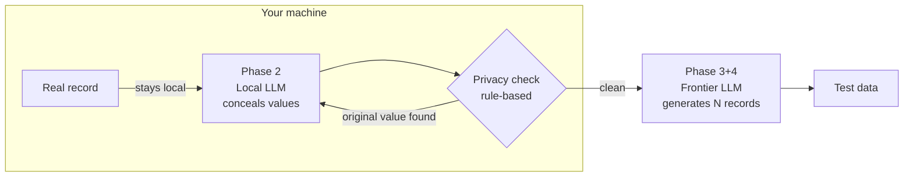

# Privacy-First Test Data Generator

**Generate realistic test data from real records – designed so that real data stays on your machine.**

> Status: v0.3 – experimental. Works for structured records. See [Limitations](#limitations).

## The problem

Many teams test with copies of production data, because synthetic data often feels "too fake" to trigger real bugs. Privacy and security teams dislike this, but it keeps happening.

Sending real customer records to a cloud LLM to generate better test data only moves the problem.

## How it works

The tool splits the job between a **local** model and a **frontier** model, with a deterministic check in between:



1. **Phase 2 – Conceal (always local):** A local model via [Ollama](https://ollama.com) replaces every value of the real record with a fictitious one, keeping structure and format.
2. **Privacy check (deterministic):** A rule-based check verifies that no original value survived, including spelling variants such as `Müller` → `Mueller` / `Muller`. If something is found, the tool retries up to three times and otherwise stops without passing anything on.
3. **Phase 3+4 – Generate:** Only the concealed record is passed to the generator (a frontier model such as GPT, or the local model) as a template for as many test records as needed.

The key idea: *the AI conceals, a transparent rule verifies.* The design does not rely on trusting the local model alone.

## What does the tool send where?

| Data | Sent by the tool to an external service? |
|---|---|
| Original record | No – it is only processed locally |
| Concealed record (shown in the UI) | Only if you choose the *Frontier* generator |
| Generated test data | Returned from the generator |

With *Local* as generator, the tool sends no data to external services.
This describes how the code is designed. Please review it yourself before using real data.

## Quickstart

Requirements: Python 3.10+, [Ollama](https://ollama.com).

```bash
# 1. Local model
ollama pull llama3.2
ollama serve            # if not already running

# 2. Project
git clone https://github.com/mubbass/privacy-first-test-data-generator.git
cd privacy-first-test-data-generator
pip install -r requirements.txt

# 3. Optional: frontier generator
cp .env.example .env    # then add your OPENAI_API_KEY

# 4. Run
python app.py
```

Open the URL shown in the terminal (usually http://127.0.0.1:7860).

## Usage

1. Enter a record, e.g. `(Müller, Thomas, Breslauer Str. 13, 56269, Dierdorf, Mitglied)`
2. Optionally list **values allowed to stay**, e.g. `Mitglied`. Categories like membership status are not personal data – you decide what is sensitive, not the AI.
3. Choose the number of records and click **CREATE**.

The UI shows the concealed record – exactly what is passed to the generator – and the result as table and JSON.

## Tests

```bash
pip install pytest
pytest
```

The tests cover the privacy check: exact matches, umlaut variants, case, partial reuse, allowed values, word boundaries and nested JSON.

## Limitations

Please read this before using the tool with sensitive data.

- **Structured records only.** The privacy check splits input at separators (`,` `;` tab, newline). Free text such as e-mails or reports is not supported yet.
- **Exact and spelling-variant matches only.** The check does not detect paraphrases or indirect identification through combinations of values (e.g. a rare job + small town + age).
- **Small local models are imperfect.** Retries are normal. The check makes leaks visible and blocks them, it does not make the local model better.
- **No legal guarantee.** This is a technical safeguard, not a certified anonymization procedure. Whether the result counts as anonymized or pseudonymized data under GDPR depends on your data and context.

## Disclaimer

This project is provided free of charge, as is, without any warranty. It is a technical aid, not legal advice and not a certified anonymization procedure. You are responsible for checking whether using it with your data complies with the data protection rules that apply to you. Use at your own risk.

## Roadmap

Ideas, not promises:

- Free-text support (e.g. synthetic customer e-mails)
- CSV / file import and export
- Multiple input records as template
- Further generator providers
- Configurable field types (sensitive / category / free)

Feedback and issues are welcome.

## License

[MIT](LICENSE)

## Author

Murat Böyükbas, Computer Scientist
